<!-- ============================================================
  Profile README for GundlapalliLokeswarRaju
  Every card in assets/ is generated by scripts/build_assets.py
  from profile.config.json. Edit the config, not the SVGs.
  Search this file for "YOUR-" to find the placeholders to fill in.
============================================================= -->

[](https://github.com/GundlapalliLokeswarRaju)



**`$ cat recruiters.txt`**

- **Data Engineer** who builds reliable pipelines, warehouses and AI-ready datasets
- Stack: **Python, SQL, Azure, Git, Machine Learning**
- Open to **internships and full-time Data / AI / Cloud roles**, remote or hybrid

**`$ cat collaborators.txt`**

- Always up for **open-source** work, **data projects** and **cloud + AI experiments**
- Got an idea? [**Say hello on LinkedIn**](https://www.linkedin.com/in/YOUR-LINKEDIN-ID)




<!-- Auto-updated by the "Update stats" workflow: your newest public repos appear here. Do not edit between the markers. -->

<!--START_PROJECTS-->
<!--END_PROJECTS-->





<b>Weekly contribution trend (click to expand)</b>

 



<!--START_SECTION:activity-->
_Recent GitHub activity will appear here after the "Update Recent Activity" workflow runs._
<!--END_SECTION:activity-->


[](mailto:YOUR-EMAIL@example.com)

<b>How this profile works</b>

- Every card is an SVG generated by [`scripts/build_assets.py`](scripts/build_assets.py) from [`profile.config.json`](profile.config.json), styled as a CRT terminal (monospace, scanlines, matrix rain).
- [`scripts/fetch_stats.py`](scripts/fetch_stats.py) runs daily and stores **only totals** in `stats.json`, with no repo names and no code.
- The snake, 3D contribution graph and activity list are refreshed by scheduled GitHub Actions.

