<!-- ═══════════════════════════════════════════════════════════════════════
     Profile README for github.com/GundlapalliLokeswarRaju
     Terminal-themed visuals in /assets are generated from profile.config.json + stats.json by
     scripts/build_assets.py (auto-runs via .github/workflows/build-assets.yml).
     Replace every YOUR-… placeholder link below with your real URL.
════════════════════════════════════════════════════════════════════════ -->

  

  
  
  
  
  

<table>
<tr>
<td width="50%" valign="top">
<h3><code>$ cat recruiters.txt</code></h3>
<ul>
<li><b>Data Engineer</b> — pipelines, warehousing and AI-ready datasets</li>
<li>Stack: <b>Python · SQL · Azure · Git · Machine Learning</b></li>
<li>Learning in public: <b>Azure data services, advanced SQL, MLOps</b></li>
<li>Open to <b>internships and full-time Data / AI / Cloud roles</b> · remote or hybrid</li>
</ul>
</td>
<td width="50%" valign="top">
<h3><code>$ cat collaborators.txt</code></h3>
<ul>
<li>Always up for <b>data projects</b>, <b>open source</b> and <b>cloud + AI experiments</b></li>
<li>Ask me about <b>Python, SQL, ETL/ELT, Azure and machine learning</b></li>
<li>Good data engineering is invisible — when it works, nobody notices</li>
<li>Got an idea? <a href="https://www.linkedin.com/in/YOUR-LINKEDIN-ID"><b>Say hello on LinkedIn</b></a></li>
</ul>
</td>
</tr>
</table>

<!-- Auto-filled by the "Rebuild profile visuals" workflow with your newest public repos (every 3 hours).
     Do not edit between the markers; change projects_count / exclude_repos in profile.config.json instead. -->
<!--START_PROJECTS-->
<table>
<tr>
<td width="50%"></td>
<td width="50%"></td>
</tr>
<tr>
<td width="50%"></td>
<td width="50%"></td>
</tr>
<tr>
<td width="50%"></td>
<td width="50%"></td>
</tr>
</table>
<!--END_PROJECTS-->

<!-- 🎬 DEMO GIFs — record 10–15s clips (ScreenToGif / Kap / CleanShot), save to assets/demos/, then uncomment:

<b>▶ Watch the demos</b>

 

  
  

-->

  
  
  
  
  

  

  

<b>📈 Weekly contribution trend</b> — click to expand

 

<!-- Generated daily by .github/workflows/profile-3d.yml -->

  

<!-- Generated daily by .github/workflows/snake.yml -->
<picture>
  <source media="(prefers-color-scheme: dark)" srcset="https://raw.githubusercontent.com/GundlapalliLokeswarRaju/GundlapalliLokeswarRaju/output/snake-dark.svg"/>
  <source media="(prefers-color-scheme: light)" srcset="https://raw.githubusercontent.com/GundlapalliLokeswarRaju/GundlapalliLokeswarRaju/output/snake-dark.svg"/>
  
</picture>

<table>
<tr>
<td width="50%" valign="top">

**✍️ Latest posts**
<!-- BLOG-POST-LIST:START -->
- Posts appear here automatically once you set the `BLOG_FEEDS` repo variable.
<!-- BLOG-POST-LIST:END -->

</td>
<td width="50%" valign="top">

**⚡ Recent GitHub activity**
<!--START_SECTION:activity-->
1. 🗣 Commented on [#2](https://github.com/GundlapalliLokeswarRaju/GundlapalliLokeswarRaju/issues/2#issuecomment-6245727232) in [GundlapalliLokeswarRaju/GundlapalliLokeswarRaju](https://github.com/GundlapalliLokeswarRaju/GundlapalliLokeswarRaju)
2. ❗ Opened issue [#2](https://github.com/GundlapalliLokeswarRaju/GundlapalliLokeswarRaju/issues/2) in [GundlapalliLokeswarRaju/GundlapalliLokeswarRaju](https://github.com/GundlapalliLokeswarRaju/GundlapalliLokeswarRaju)
3. ❗ Opened issue [#1](https://github.com/GundlapalliLokeswarRaju/GundlapalliLokeswarRaju/issues/1) in [GundlapalliLokeswarRaju/GundlapalliLokeswarRaju](https://github.com/GundlapalliLokeswarRaju/GundlapalliLokeswarRaju)
<!--END_SECTION:activity-->

</td>
</tr>
</table>

  <b>Passing by? Leave your mark.</b> Click below, then press <i>Submit</i> — a GitHub Action adds your avatar to this wall within a minute.

  

<!-- GUESTBOOK:START -->

  

1 person has signed · newest first

<!-- GUESTBOOK:END -->

  
  
  

  

⚙️ How this profile works

 

- Every card is an SVG generated by [`scripts/build_assets.py`](scripts/build_assets.py) from [`profile.config.json`](profile.config.json), styled as a CRT terminal (JetBrains Mono, scanlines, Matrix rain).
- [`scripts/fetch_stats.py`](scripts/fetch_stats.py) runs every few hours and publishes **only totals, language percentages and your public repos** — no private repo names, no code.
- Featured projects fill themselves from your newest public repositories.
- The guestbook is issue-driven: opening a `guestbook|hi` issue triggers [a workflow](.github/workflows/guestbook.yml) that adds your avatar.
- The snake, 3D graph and activity feed are refreshed by scheduled GitHub Actions.

